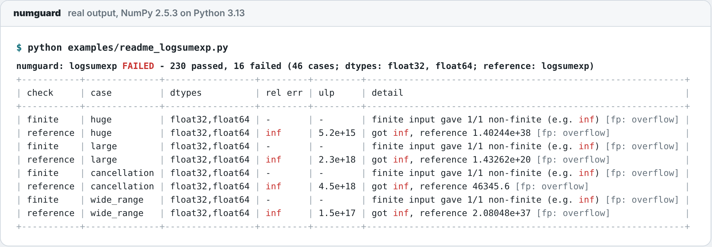
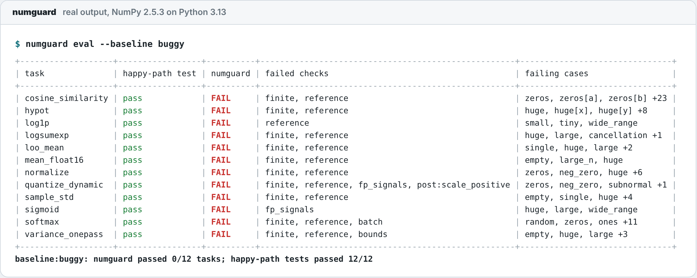

<p align="center">
  
</p>

<p align="center">
  <b>numguard tests array functions on the inputs that break numerical code.</b><br>
  It throws zeros, empty arrays, NaN, ±inf, overflow-sized and subnormal values, cancellation-prone data<br>
  and float16 at your function, and checks every answer against a reference, invariants and the dtype's limits.
</p>

<p align="center">
  <a href="https://github.com/bhaskargurram-ai/numguard/actions/workflows/ci.yml"></a>
  <a href="LICENSE"></a>
  
  
  
</p>

It is aimed at a kind of bug that AI coding assistants, and people, write all the time: code that runs, passes the obvious test, and returns silently wrong numbers on edge cases.

```python
import numpy as np
import scipy.special
import numguard

def logsumexp(x):                       # what an assistant often writes first
    return np.log(np.sum(np.exp(x)))

assert np.isclose(logsumexp(np.array([1.0, 2.0, 3.0])), 3.40760596)  # happy path: passes

report = numguard.check(logsumexp, reference=scipy.special.logsumexp,
                        properties=["translation_equivariant"])
print(report.summary())
```

<p align="center">
  <picture>
    <source media="(prefers-color-scheme: dark)" srcset="docs/images/logsumexp-report-dark.png">
    
  </picture>
  <br><sub>Real output of <a href="examples/readme_logsumexp.py"><code>examples/readme_logsumexp.py</code></a> (NumPy 2.5.3, Python 3.13). The <code>cancellation</code> row is ordinary data with a large offset, like <code>46341 + [0, 1, 2, 3, 4]</code> in float32 or timestamps in float64: the right answer is about 46345.6 and the naive version returns <code>inf</code>.</sub>
</p>

> [!NOTE]
> **Status: 1.0.0.** The edge-case catalogue, checks, pytest plugin, config file, bug corpus and GitHub workflows are deterministic and need no LLM. The agent commands (`suggest`, `fix`, `bench`) are **experimental, opt-in and bring-your-own-key**: whatever a model writes counts only after numguard has executed it and re-run the checks. NumPy is the tested backend; PyTorch, JAX and CuPy are supported when installed.

## Contents

- [Why edge cases?](#why-edge-cases)
- [How it works](#how-it-works)
- [Quick start](#quick-start)
- [The edge-case catalogue](#the-edge-case-catalogue)
- [Checks](#checks)
- [pytest plugin](#pytest-plugin)
- [Config file](#config-file)
- [Backends](#backends)
- [Hypothesis strategies](#hypothesis-strategies)
- [The bug corpus](#the-bug-corpus)
- [Agent (experimental)](#agent-experimental): [`suggest`](#numguard-suggest), [`fix`](#numguard-fix), [`bench`](#numguard-bench)
- [GitHub integration](#github-integration)
- [Security model](#security-model)
- [How numguard compares](#how-numguard-compares)
- [Configuration and CLI reference](#configuration-and-cli-reference)
- [FAQ](#faq)
- [Limitations](#limitations)
- [Roadmap](#roadmap)
- [Contributing](#contributing) · [License](#license)

## Why edge cases?

A happy-path test for numerical code checks one comfortable input, usually something like `[1.0, 2.0, 3.0]`. The bugs live elsewhere:

- **Overflow and underflow.** `exp(x)` overflows float32 above 88.7; `x * x` overflows above 1.8e19 and underflows to zero below about 1e-19. `sqrt(x**2 + y**2)`, naive norms, softmax and logsumexp all fall over there.
- **Cancellation.** `E[x²] − E[x]²` for `1e9 + [1, 2, 3]` is `0.0` in float64; the variance is 0.667.
- **Precision loss.** `log(1 + x)` is `0.0` for `x = 1e-17`; `log1p` gives `1e-17`.
- **Degenerate shapes and values.** An all-zero input gives a zero norm or a zero quantization scale; `n = 1` gives NaN for a sample standard deviation; an empty array gives a warning and NaN.
- **Low precision.** NumPy's own `np.var` of 100,000 float16 values between 1 and 2 returns `inf` (NumPy 2.5.3): the float16 accumulator overflows. The answer is about 0.083.

numguard asks the questions a numerical analyst would ask of your function, and answers them by running it:

- Does it stay **finite** where the true answer is finite?
- Does it **agree with a trusted reference**, ideally a higher-precision one, within a tolerance you can state in ULPs?
- Does it keep the **invariants** it should: shifting, scaling, permuting, batching, monotonicity, bounds?
- Does it **respect its dtype**: no silent upcasting, no in-place mutation of its inputs, NaN handled the way you said?

A careful implementation passes; a plausible-looking naive one gets a table that shows exactly which input breaks it and how.

## How it works

<p align="center">
  
</p>

1. **Contract.** You describe each argument (shape, domain such as `positive` or `"(-1, inf)"`, optional fixed dtype) and what should hold: a reference, properties, bounds, tolerances. Everything is optional; with nothing declared, numguard infers one 1-D array per positional parameter and still runs the dtype-limit checks.
2. **Cases.** The catalogue generates every [edge-case kind](#the-edge-case-catalogue) for every dtype under test. Values outside an argument's domain are never generated, and with several arguments each kind is also applied to one argument at a time (`zeros[b]`). Cases are deterministic for a given seed.
3. **Run.** Each case runs through the [backend](#backends) (NumPy by default). numguard records floating-point signals (`overflow`, `invalid`, `divide`) and snapshots the inputs so in-place edits are caught.
4. **Check.** Fixed rules compare the outputs with the reference (rounded to the output dtype), with metamorphic properties and with the dtype's limits. Failures carry the case, dtype, max relative error, ULP distance and FP signals.
5. **Report.** A table and JSON, a failing pytest item, a non-zero exit code, or a card on the pull request.

An LLM never decides a result. The [agent](#agent-experimental) can draft a spec or propose a rewrite, and either one only counts after numguard has executed it.

## Quick start

### 1. Install

```bash
pip install numguard                                                  # once 1.0.0 is published to PyPI
pip install "git+https://github.com/bhaskargurram-ai/numguard@v1.0.0" # or straight from GitHub
```

The only runtime dependencies are NumPy and click. Extras: `numguard[pytest]`, `numguard[scipy]`, `numguard[mpmath]` (arbitrary-precision references), `numguard[hypothesis]` (strategies), `numguard[dev]` (everything for working on numguard). Python 3.10 or newer.

### 2. Check a function

From Python:

```python
import numpy as np
import numguard

report = numguard.check(
    my_variance,                                  # function under test
    inputs=numguard.Array("n", domain="any"),     # optional; inferred from the signature
    reference=np.var,                             # optional trusted implementation
    properties=["translation_invariant", "scale_equivariant:2", "permutation_invariant"],
    dtypes=["float16", "float32", "float64"],     # default: float32, float64
)
report.ok                  # bool
report.failures            # list[CheckResult]: check, case, dtype, message, max abs/rel/ULP error, FP signals
print(report.summary())    # the table above
report.to_json()
report.raise_if_failed()   # raises numguard.NumGuardError (an AssertionError) with the table
```

From the shell (exit status 1 on any failure):

```bash
numguard check mypkg.stats:my_variance --ref numpy:var --dtype float16 --dtype float32 \
    --prop translation_invariant --prop permutation_invariant
numguard check path/to/file.py:softmax --batched --fp-signals fail --json
```

Or attach the contract to the function itself. `@numguard.guard(...)` takes the same arguments and does not change the function's behaviour:

```python
@numguard.guard(reference=scipy.special.softmax, batched=True, bounds=(0, 1),
                properties=["translation_invariant"])
def softmax(x):
    ...
```

### 3. Run it in your tests

```python
import pytest, scipy.special
from mypkg.ops import logsumexp

@pytest.mark.numguard(fn=logsumexp, reference=scipy.special.logsumexp,
                      properties=["translation_equivariant"])
def test_logsumexp_edge_cases():
    pass                                  # the test body runs first, then numguard checks fn
```

```bash
pytest --numguard-modules mypkg.ops       # every @numguard.guard function becomes a test item
```

Notebooks work the same way as scripts: `numguard.check(...).summary()` prints the table in a cell.

### 4. Add it to CI

From the root of your repository:

```bash
numguard init              # add --agent to also set up the experimental fix agent
```

`init` writes a commented [`numguard.toml`](#config-file) and the caller workflows below, refuses to overwrite existing files unless you pass `--force`, and prints the next steps. List your functions as `[[target]]` tables in `numguard.toml`, commit, and open a pull request. The files in [`examples/workflows/`](examples/workflows) are exactly what `init` generates.

numguard runs as separate workflows so that the pull request's code and privileged tokens never share a job ([why](#security-model)). Each caller is a few lines that point at a reusable workflow in this repository. Pin `@v1.0.0`, or a full commit SHA if you want to be strict.

**`.github/workflows/numguard.yml`** runs the checks. It is unprivileged and is where PR code runs.

```yaml
name: numguard

on:
  pull_request:

permissions:
  contents: read

concurrency:
  group: numguard-${{ github.event.pull_request.number }}
  cancel-in-progress: true

jobs:
  check:
    uses: bhaskargurram-ai/numguard/.github/workflows/check.yml@v1.0.0
    with:
      numguard-ref: v1.0.0
      python-version: "3.12"
      # Installs the project under test; this runs PR code (unprivileged job).
      install-command: 'pip install -e ".[dev]" || pip install -e .'
      config: numguard.toml
      pytest: false          # true: also run pytest with the numguard plugin
      fail-on: failures      # or "never" to report without failing the check
```

**`.github/workflows/numguard-comment.yml`** posts the card. It is privileged and never runs PR code.

```yaml
name: numguard comment

on:
  workflow_run:
    workflows: ["numguard"]   # must match the `name:` of numguard.yml
    types: [completed]

permissions: {}

jobs:
  comment:
    if: github.event.workflow_run.event == 'pull_request' && github.event.workflow_run.conclusion != 'cancelled'
    permissions:
      contents: read
      actions: read          # download the artifact of the triggering run
      pull-requests: write   # upsert the sticky comment and the label
    uses: bhaskargurram-ai/numguard/.github/workflows/comment.yml@v1.0.0
    with:
      numguard-ref: v1.0.0
      labels: true
```

**`.github/workflows/numguard-agent.yml`** *(optional, experimental, written by `init --agent`)* proposes a verified rewrite for each failing target. It runs only for PRs labelled `numguard:agent` or opened by owners, members and collaborators, unless you set `run-for: everyone`.

```yaml
name: numguard agent

on:
  workflow_run:
    workflows: ["numguard"]   # must match the `name:` of numguard.yml
    types: [completed]

permissions: {}

jobs:
  agent:
    if: github.event.workflow_run.event == 'pull_request' && github.event.workflow_run.conclusion != 'cancelled'
    permissions:
      contents: read
      actions: read
      pull-requests: read
    uses: bhaskargurram-ai/numguard/.github/workflows/agent.yml@v1.0.0
    with:
      numguard-ref: v1.0.0
      llm-provider: ${{ vars.NUMGUARD_LLM_PROVIDER }}
      llm-model: ${{ vars.NUMGUARD_LLM_MODEL }}
      llm-base-url: ${{ vars.NUMGUARD_LLM_BASE_URL }}
      llm-reasoning-effort: ${{ vars.NUMGUARD_LLM_REASONING_EFFORT }}
      python-version: "3.12"
      install-command: 'pip install -e ".[dev]" || pip install -e .'
      rounds: 3
      run-for: trusted   # or "everyone" (spends API credits on any fork PR)
    secrets:
      llm-api-key: ${{ secrets.NUMGUARD_LLM_API_KEY }}

  comment:
    needs: agent
    if: needs.agent.outputs.verified == 'true'
    permissions:
      contents: read
      actions: read
      pull-requests: write
    uses: bhaskargurram-ai/numguard/.github/workflows/comment.yml@v1.0.0
    with:
      numguard-ref: v1.0.0
      # Trusted values: the PR number comes from the agent's gate job (API data,
      # no PR code ran there) and the artifact from this run's verify job.
      pr-number: ${{ needs.agent.outputs.pr-number }}
      artifact-run-id: ${{ github.run_id }}
      labels: true
```

For the agent, add a repository **secret** `NUMGUARD_LLM_API_KEY` and repository **variables** `NUMGUARD_LLM_PROVIDER` (`anthropic` or `openai`) and `NUMGUARD_LLM_MODEL` (optional: `NUMGUARD_LLM_BASE_URL` and `NUMGUARD_LLM_REASONING_EFFORT`). The key is only passed to the propose job, which never runs PR code.

On fork PRs the check workflow has no write token, so the card also appears in the run's **job summary** before the comment workflow posts it.

<details>
<summary><b>Use the composite action directly</b></summary>

The `bhaskargurram-ai/numguard@v1.0.0` composite action ([`action.yml`](action.yml)) wraps the same steps for custom setups. The reusable workflows above are the recommended setup because they keep the trust zones apart for you.

</details>

## The edge-case catalogue

<p align="center">
  
</p>

The catalogue is placed where naive formulas break, for each dtype under test. `numguard cases` lists every kind with its tags.

| kind | what it contains | tags |
|---|---|---|
| `random` | seeded normal (or in-domain) values | regular |
| `zeros`, `neg_zero` | all `0.0` / all `-0.0` | regular / signed_zero |
| `ones`, `constant` | constant arrays | regular |
| `empty`, `single`, `pair`, `large_n` | sizes 0, 1, 2 and `large_n` (default 100,000) | size |
| `nan`, `posinf`, `neginf` | one non-finite value among regular ones | nonfinite_input |
| `huge` | 25–50 % of `finfo.max` | extreme, overflow_prone |
| `large` | 2–8 × `sqrt(finfo.max)`, so squares overflow | extreme, overflow_prone |
| `small` | 1–100 × `eps` | extreme, precision |
| `tiny`, `subnormal` | just above `finfo.tiny` / small multiples of the smallest subnormal | extreme, underflow_prone |
| `wide_range` | geometric sweep from `tiny` to `max` | extreme |
| `cancellation` | large offset, small spread: `16/sqrt(eps) + [0..4]` (≈ `46341 + …` in float32) | extreme, precision |
| `alternating` | `1, -2, 3, -4, …` | regular, mixed_sign |
| `duplicates`, `sorted`, `reverse_sorted` | orderings and ties | regular |
| `boundary` | closed/open interval endpoints (via `nextafter`) | |
| `int_min`, `int_max` | integer range limits | boundary |

**Domains.** Each argument has a domain: `any`, `positive`, `nonneg`, `negative`, `nonpos`, `unit_interval`, interval notation like `"(-1, inf)"`, or integer ranges like `"int[0, 255]"`. A `positive` argument never receives zeros or negatives, and on `(-1, inf)` the `huge` values are positive. Add your own with `extra_cases={"name": arrays}`.

Patterns in `include`, `exclude`, `allow_nonfinite`, `may_raise` and `ignore` match a case name (glob), its kind or any of its tags, so `allow_nonfinite=["overflow_prone"]` covers `huge`, `large` and `wide_range` at once.

## Checks

| check | fails when |
|---|---|
| `error` | the function raises (unless the case matches `may_raise`, or the reference raises too) |
| `mutation` | the function modifies its input arrays in place |
| `dtype` | a floating output does not keep the input dtype (or does not match `out_dtype`) |
| `finite` | finite inputs produce inf/NaN that the reference (rounded to the output dtype) does not |
| `nan` | `nan="propagate"`: NaN input gives an output with no NaN. `nan="raise"`: no exception |
| `reference` | values differ from the reference beyond `rtol`/`atol` (reports max abs/rel error and ULPs) |
| `fp_signals` | opt-in: an overflow / invalid / divide-by-zero signal on finite input |
| `bounds` | opt-in: finite output outside `bounds=(lo, hi)` |
| `post:<name>` | opt-in: a postcondition `post(args, outputs)` returns False or a message |
| `batch` | `batched=True`: `f(stack(xs, axis)) != stack(f(x) for x in xs)` |
| `monotonic` | `monotonic="increasing"/"decreasing"`: the order is violated on sorted inputs |
| `prop:<name>` | a metamorphic property fails |

Floating-point signals raised while the function runs are recorded on every result (`[fp: overflow]` in the table) as evidence. They only cause failures with `fp_signals="fail"`.

**Properties** are strings with an optional `:value`, or `numguard.Property` objects: `permutation_invariant`, `permutation_equivariant`, `translation_invariant[:c]`, `translation_equivariant[:c]`, `scale_invariant[:factor]`, `scale_equivariant[:exponent]` (the default factor 2 is exact in binary floating point), `symmetric`, `odd`, `even`. They are checked on regular cases; a transformed input that would leave the domain is skipped.

**Tolerances.** Defaults are rtol 1e-2 for float16, 1e-5 for float32 and 1e-12 for float64. Relative errors are measured against `max(|expected|, finfo.tiny)`. Pass `rtol`/`atol` as numbers, or as dicts keyed by dtype name such as `{"float32": 1e-4, "uint8": 1}`.

<details>
<summary><b>High-precision references and ULPs</b></summary>

A plain reference receives float64-upcast inputs. For a reference that is genuinely more accurate than float64:

```python
ref = numguard.longdouble(np.log1p)           # evaluates on np.longdouble inputs
ref = numguard.highprec(numpy_fn=np.log1p,    # mpmath if installed, else long double
                        mp_fn=lambda x: mpmath.log1p(x), dps=50)
numguard.check(my_log1p, reference=ref, domain="(-1, inf)")
```

`np.longdouble` is 80-bit extended precision on most x86-64 Linux builds. Where it is plain float64 (Windows, macOS arm64), numguard falls back to float64 and labels the reference that way. `numguard.ulp_distance(a, b)` counts the representable values between `a` and `b`; signed zeros count as equal, and so do two NaNs.

</details>

<details>
<summary><b>All <code>check()</code> options</b></summary>

`inputs=`, `domain=`, `reference=`, `properties=`, `dtypes=`, `rtol=`, `atol=`, `nan="propagate" | "raise" | "ignore"`, `allow_nonfinite=[...]`, `may_raise=[...]`, `out_dtype=` (default `"preserve"`), `batched=`, `batch_axis=`, `monotonic=`, `bounds=`, `fp_signals="ignore" | "fail"`, `postconditions=[fn]`, `extra_cases={...}`, `include=`/`exclude=`, `ignore=["check:pattern"]`, `kwargs=` (forwarded to the function), `ref_kwargs=`, `n=`, `large_n=`, `seed=`, `backend=`. `@numguard.guard`, the pytest marker and `[[target]]` tables accept the same names.

</details>

**What the checks can't tell you.** Without a reference, the `finite` check can't tell a result that legitimately overflows (such as `hypot(1.7e308, 1.7e308)`) from a bug: pass a reference or mark such cases with `allow_nonfinite`. numguard tests the cases it generates against the contract you declare. It does not prove correctness.

## pytest plugin

Installing numguard registers a pytest plugin (`pytest11` entry point). Use it two ways:

- **Marker.** `@pytest.mark.numguard(fn=..., **check_options)`. The test body runs first, then numguard checks `fn`; any failure fails the test with the summary table as its message.
- **Auto-collection.** Every `@numguard.guard`-decorated function in the listed modules becomes a test item:

```bash
pytest --numguard-modules mypkg.ops,mypkg.stats
pytest --numguard-dtypes float16,float32 --numguard-large-n 1000000
```

`numguard_modules` can also be set in `[tool.pytest.ini_options]`. In CI, set `pytest: true` in the check workflow to run your suite with the plugin and put its numguard failures on the card.

## Config file

`numguard.toml` lists functions to check without touching their source, which is what CI uses. `numguard check --config numguard.toml` runs every target; `numguard init` writes a commented starting point.

```toml
[defaults]                                  # optional, applies to every target
dtypes = ["float32", "float64"]
backend = "numpy"
seed = 0

[[target]]
function = "mypkg.ops:logsumexp"
inputs = { x = "any" }                      # domain per argument
reference = "scipy.special.logsumexp"       # expression over numpy, scipy, math, mpmath
properties = ["translation_equivariant"]
rtol = { float32 = 1e-5, float64 = 1e-12 }

[[target]]
function = "mypkg.ops:log1p"
domain = "(-1, inf)"
highprec = "lambda x: mpmath.log1p(x)"      # mpmath reference at high precision
monotonic = "increasing"
dtypes = ["float16", "float32", "float64"]

[[target]]
function = "mypkg.quant:quantize_dynamic"
inputs = { x = "any" }
allow_nonfinite = ["nonfinite_input"]
fp_signals = "fail"
```

Every key of [`check()`](#checks) can appear in a `[[target]]` table. Reference expressions are compiled in a restricted namespace that contains only `numpy` (`np`), `scipy.special`, `math` and `mpmath`. In the GitHub workflow **the file is read from the PR's base commit**, so a pull request cannot loosen its own checks.

## Backends

Cases are always generated in NumPy. With `backend="torch"`, `"jax"` or `"cupy"` (CLI: `--backend`, config: `backend =`), numguard converts each input to the backend's array type (through DLPack where possible), calls your function, and converts the outputs back with `np.asarray` before checking. `bfloat16` is available as a dtype when [`ml_dtypes`](https://github.com/jax-ml/ml_dtypes) is importable.

| backend | status |
|---|---|
| `numpy` | default; tested in CI |
| `torch`, `jax`, `cupy` | supported if installed; the adapter is tested against a fake backend module, not against the real libraries in CI |

Device placement, gradients and backend-specific dtypes such as `float8` are not covered yet (see the [roadmap](#roadmap)).

## Hypothesis strategies

If you already use [Hypothesis](https://hypothesis.readthedocs.io/), `numguard.strategies` gives it numguard's catalogue: draws come from the named edge cases as well as random arrays, constrained to the declared domain and dtype. Install with `numguard[hypothesis]`; the module imports Hypothesis lazily, so numguard itself does not depend on it.

```python
from hypothesis import given
import numguard.strategies as ngs

@given(ngs.arrays(dtype="float32", domain="(-1, inf)"))
def test_log1p_monotone_and_finite(x):
    ...

@given(ngs.inputs_for(logsumexp))          # uses the function's @numguard.guard spec
def test_logsumexp_matches_scipy(args):
    ...
```

This keeps Hypothesis's shrinking and its database of past failures, and adds the inputs numerical code tends to get wrong.

## The bug corpus

[`corpus/`](corpus) contains 12 self-contained tasks, each **inspired by a real class of numerical bug** in AI-written and human-written array code. Each task folder has:

- `task.md`: the prompt a coding agent receives (function name, signature, contract)
- `buggy.py`: a plausible naive implementation that **passes a happy-path test**
- `reference.py`: a correct implementation
- `spec.py`: the numguard spec (inputs, domain, properties, reference, happy-path test)

| task | bug class |
|---|---|
| `quantize_dynamic` | dynamic uint8 quantization: all-zero input gives `scale = 0`, which turns into NaN downstream |
| `logsumexp`, `softmax` | `exp` overflow on large logits; softmax normalized over the whole batch |
| `variance_onepass` | `E[x²] - E[x]²` cancellation: `1e9 + [1, 2, 3]` gives `0.0` in float64 and `-9.2e10` in float32 |
| `mean_float16` | float16 accumulator overflows on 100k elements |
| `sample_std` | `n = 1` gives NaN instead of an error, plus overflow/underflow of squared deviations |
| `log1p` | `log(1 + x)` loses all precision for tiny `x` |
| `cosine_similarity`, `normalize` | division by a zero norm, and overflow in `‖x‖²` |
| `sigmoid` | `exp(-x)` overflows for very negative inputs |
| `hypot` | `sqrt(x² + y²)` overflows and underflows |
| `loo_mean` | closed-form leave-one-out mean cancels catastrophically when one value dominates, and `n = 1` |

The quantization task is modelled on the all-zero-input case of ONNX `DynamicQuantizeLinear`, where the textbook formula gives a zero scale; the author contributed a fix for this case to the ONNX specification. The other tasks are generic bug classes and don't refer to specific upstream issues.

Grade the bundled versions:

```bash
numguard eval --baseline buggy        # exit 0 only if every buggy version is caught
numguard eval --baseline reference    # exit 0 only if every reference passes
```

<p align="center">
  <picture>
    <source media="(prefers-color-scheme: dark)" srcset="docs/images/eval-buggy-dark.png">
    
  </picture>
</p>

**All 12 buggy versions pass their happy-path test, and numguard catches all 12. All 12 references pass.** These are the only scoreboard numbers in this README, and both were measured (NumPy 2.5.3, Python 3.13).

<details>
<summary><b>Both scoreboards as text</b></summary>

```text
$ numguard eval --baseline buggy
+-------------------+-----------------+----------+----------------------------------------------------+-------------------------------+
| task              | happy-path test | numguard | failed checks                                      | failing cases                 |
+-------------------+-----------------+----------+----------------------------------------------------+-------------------------------+
| cosine_similarity | pass            | FAIL     | finite, reference                                  | zeros, zeros[a], zeros[b] +23 |
| hypot             | pass            | FAIL     | finite, reference                                  | huge, huge[x], huge[y] +8     |
| log1p             | pass            | FAIL     | reference                                          | small, tiny, wide_range       |
| logsumexp         | pass            | FAIL     | finite, reference                                  | huge, large, cancellation +1  |
| loo_mean          | pass            | FAIL     | finite, reference                                  | single, huge, large +2        |
| mean_float16      | pass            | FAIL     | finite, reference                                  | empty, large_n, huge          |
| normalize         | pass            | FAIL     | finite, reference                                  | zeros, neg_zero, huge +6      |
| quantize_dynamic  | pass            | FAIL     | finite, reference, fp_signals, post:scale_positive | zeros, neg_zero, subnormal +1 |
| sample_std        | pass            | FAIL     | finite, reference                                  | empty, single, huge +4        |
| sigmoid           | pass            | FAIL     | fp_signals                                         | huge, large, wide_range       |
| softmax           | pass            | FAIL     | finite, reference, batch                           | random, zeros, ones +11       |
| variance_onepass  | pass            | FAIL     | finite, reference, bounds                          | empty, huge, large +3         |
+-------------------+-----------------+----------+----------------------------------------------------+-------------------------------+
baseline:buggy: numguard passed 0/12 tasks; happy-path tests passed 12/12

$ numguard eval --baseline reference
+-------------------+-----------------+----------+---------------+---------------+
| task              | happy-path test | numguard | failed checks | failing cases |
+-------------------+-----------------+----------+---------------+---------------+
| cosine_similarity | pass            | pass     |               |               |
| hypot             | pass            | pass     |               |               |
| log1p             | pass            | pass     |               |               |
| logsumexp         | pass            | pass     |               |               |
| loo_mean          | pass            | pass     |               |               |
| mean_float16      | pass            | pass     |               |               |
| normalize         | pass            | pass     |               |               |
| quantize_dynamic  | pass            | pass     |               |               |
| sample_std        | pass            | pass     |               |               |
| sigmoid           | pass            | pass     |               |               |
| softmax           | pass            | pass     |               |               |
| variance_onepass  | pass            | pass     |               |               |
+-------------------+-----------------+----------+---------------+---------------+
baseline:reference: numguard passed 12/12 tasks; happy-path tests passed 12/12
```

</details>

### Grading any coding agent

The harness only reads files, so any agent, or a person, can be graded:

1. For each task, give the agent the contents of `task.md` (`numguard tasks --show <task>` prints it).
2. Save the answer as `DIR/<task>/solution.py`, defining the function named in the task.
3. Run `numguard eval --candidate-dir DIR [--json-out results.json]`.

Missing solutions are reported as `missing` and solutions that fail to import as `error`. `--task NAME` (repeatable) grades a subset and `--solution-name` handles another file name. `solution.py` is imported and run **in-process**: grade untrusted code inside a container. [`numguard bench`](#numguard-bench) automates all three steps for an LLM.

## Agent (experimental)

Three commands use an LLM. All three are **off unless you call them**, need your own API key, and follow the same rule as the rest of numguard: **the model proposes, numguard executes, and only the executed result counts.**

| command | the model writes | numguard then |
|---|---|---|
| `numguard suggest` | a spec: domains, dtypes, properties, a reference, tolerances | runs the spec; flags the reference as *suspect* if it disagrees with your function on benign inputs |
| `numguard fix` | a rewrite of a failing function, same signature | verifies it in a sandboxed subprocess against every check; accepts it only if all of them pass |
| `numguard bench` | solutions to the 12 corpus tasks | grades them with `numguard eval` and prints a leaderboard row |

<p align="center">
  
</p>

Configure the model through environment variables (never a config file):

```bash
export NUMGUARD_LLM_PROVIDER=anthropic          # or openai (any OpenAI-compatible endpoint)
export NUMGUARD_LLM_API_KEY=...                 # stripped from every subprocess numguard starts
export NUMGUARD_LLM_MODEL=...                   # required; there is no default model
# optional: NUMGUARD_LLM_BASE_URL, NUMGUARD_LLM_REASONING_EFFORT
```

The client supports the Anthropic Messages API and OpenAI-compatible chat completions, with retries and token and cost accounting. Two provider quirks: OpenAI's GPT-6 Luna only calls tools through Chat Completions with `NUMGUARD_LLM_REASONING_EFFORT=none`, and GPT-6 models reject `temperature` unless reasoning is off.

### `numguard suggest`

```bash
numguard suggest mypkg.ops:logsumexp --write specs/logsumexp_spec.py
```

The model gets read-only tools: the function's source and docstring, call sites and tests found by searching the repository, and the lists of numguard domains, properties and reference helpers. Its only output is a submit call validated against a strict schema. numguard compiles the reference in a restricted namespace (`numpy`, `scipy.special`, `math`, `mpmath` only) and runs the spec. **If the reference disagrees with your function on benign random inputs, numguard marks the reference as suspect instead of reporting bugs**: a wrong reference is more likely than a function that is wrong everywhere. Output: a ready-to-paste `@numguard.guard(...)` decorator (or spec file with `--write`) plus the check report.

### `numguard fix`

```bash
numguard fix mypkg.ops:logsumexp --rounds 3            # prints a diff; changes nothing
numguard fix mypkg.ops:logsumexp --spec specs/logsumexp_spec.py --apply
```

In the spirit of Herbie, but verified by execution rather than by search: when checks fail, the model proposes a rewrite, and numguard runs it in a subprocess with a timeout, a scrubbed environment and a static denylist. A rewrite is accepted only if it

- passes **every** check the original failed,
- introduces **no new** failures,
- matches the reference (or the original function on benign inputs) within tolerance, and
- keeps the original's dtype and shape behaviour.

Otherwise the new failure table goes back to the model for another round, up to `--rounds` (default 3). The result is a unified diff and a before/after table. **Files change only with `--apply`.**

### `numguard bench`

```bash
numguard bench --model my-model-id --tasks logsumexp,softmax,hypot --out-dir runs/my-model
```

Sends each task's `task.md` to the model (no tools), saves `solution.py` per task, then runs the normal eval. It prints a leaderboard row (model, pass@1 over the tasks, happy-path pass rate, per-task failure reasons) and writes JSON.

**Be realistic about it.** We have not published `bench` results for any model, and we have not measured how often `fix` finds a verified rewrite: there are no agent numbers in this README because none were measured. A rewrite that passes verification has passed numguard's cases, not been proven correct; review it like any other patch. The corpus has 12 tasks, which is enough to show differences between a naive and a careful implementation, and far too few to rank models with confidence.

## GitHub integration

The check workflow runs `numguard check --config numguard.toml` (and pytest with the plugin, if enabled), writes a Markdown **card** to the job summary, and uploads `result.json`, `card.md` and the PR number as an artifact. The privileged comment workflow turns that into one sticky PR comment.

| Section | What it shows |
|---|---|
| **Verdict** | One line: all targets pass, or how many targets and checks fail. With `labels: true` the PR gets a matching `numguard:` label. |
| **Failures** | Per target, the same table as the CLI: check, case, dtypes, relative error, ULPs, detail. Long tables are capped. |
| **Suggested fix (verified)** | Only when the agent ran and a rewrite passed verification: a collapsible unified diff and before/after table. |
| **Data block** | Invisible: a `<!-- numguard:data {...} -->` comment with the verdict and counts as JSON, built from validated fields only (escaped and size-capped), for bots and scripts. |

## Security model

Running a pull request's code next to a token or an API key is the dangerous part. numguard splits the work into three trust zones connected only by artifacts:

<p align="center">
  
</p>

- **PR code runs only in jobs without secrets.** The check job runs on `pull_request` with `contents: read`, `persist-credentials: false`, timeouts, and `numguard.toml` read from the **base** commit. The agent's verify job has no secrets either.
- **The LLM key never meets PR code.** The propose job reads files as data and never installs, imports or runs them. The model's tools are read-only and its only output is a schema-validated submit call. Untrusted text (source, docstrings, reports) is delimited as data in prompts.
- **Model-written code is never trusted.** It runs in a subprocess with a timeout, an environment with secret-looking variables removed, and a static denylist (imports of `os`, `subprocess`, `socket`, `shutil`, `ctypes`, `importlib`; `eval`, `exec`, `__import__`; `open(...)` for writing). Only the re-checked outcome counts.
- **The privileged comment job never checks out or executes PR code.** It validates `result.json` strictly, re-renders the card from validated data (the uploaded `card.md` is ignored), and escapes everything PR-derived.
- **Never `pull_request_target` together with a checkout of the PR head.** That pattern runs attacker code with a write token and your secrets. The repository's own tests check the shipped workflows for it, for secrets in PR-code jobs, for `${{ github.event.* }}` interpolated into `run:` steps, and for minimal permissions.

The subprocess denylist is a speed bump, not a sandbox: Python can reach most things in many ways. The real isolation on GitHub is the job split. Locally, `numguard fix` runs the candidate in a subprocess on your machine; run it in a container if you don't trust the model. A malicious PR can still tamper with its own results inside the unprivileged job. See [docs/SECURITY_MODEL.md](docs/SECURITY_MODEL.md) and [docs/AGENT.md](docs/AGENT.md).

## How numguard compares

Different tools answer different questions. This is our best reading of each as of October 2026; corrections are welcome.

| | [Herbie](https://herbie.uwplse.org/)<br><sub>PLDI 2015, uwplse</sub> | [Hypothesis](https://hypothesis.readthedocs.io/)<br><sub>+ `hypothesis.extra.numpy`</sub> | [`numpy.testing`](https://numpy.org/doc/stable/reference/routines.testing.html) | SciCode-style benchmarks<br><sub>SciCode, FEM-Bench, ODE-1000</sub> | **numguard**<br><sub>1.0.0</sub> |
|---|---|---|---|---|---|
| Main question | Can this floating-point expression be rewritten to be more accurate? | Does a property hold across generated inputs? | Are these arrays equal or close? | How good is a model at writing scientific code? | **Does my array function survive numerical edge cases?** |
| Input | An expression in FPCore (or Herbie's math syntax) | Any Python test | Arrays you construct | A fixed task set | Your Python array functions |
| Numerical edge cases | Samples inputs across the float range | `floats()` reaches NaN, ±inf, ±0 and subnormals; no catalogue of overflow thresholds, cancellation or `large_n` | None; you pick the inputs | Hidden test cases per task | **Named catalogue per dtype and domain** |
| High-precision oracle | Yes (arbitrary precision) | Bring your own | Bring your own | Task-specific | Optional: mpmath or long double |
| Error in ULPs | Bits of error | No | `assert_array_max_ulp` | No | Max relative error and ULPs per case |
| Minimal failing input | n/a | **Yes, shrinking** | n/a | n/a | No: cases are fixed and small |
| Rewrites code | **Yes, its core feature** | No | No | No | Experimental agent; accepted only if every check passes |
| Runs in pytest / CI | No (standalone tool and web UI) | Yes | Yes | No | Yes, plus a PR card |
| Grades AI coding agents | No | No | No | **Yes, at scale** | 12-task corpus |

These tools are complementary. Herbie's search-based rewriting with a real accuracy measure is far more principled than an LLM proposing a fix; if your hot path is a scalar expression, try Herbie first. Hypothesis is better at finding *new* failing inputs and shrinking them; `numguard.strategies` exists so you can use both. `numpy.testing` is what numguard's own comparisons are built on. Benchmarks such as SciCode measure models on many problems; numguard's 12-task corpus is a small, targeted complement, not a substitute.

**numguard's own gaps:** no shrinking and no search beyond its catalogue and seeded random inputs; no proofs; the corpus is small; backends other than NumPy are not exercised against the real libraries in CI; agent rewrites are LLM proposals filtered by tests, not synthesized with an accuracy guarantee.

## Configuration and CLI reference

<details>
<summary><b><code>numguard.toml</code> keys</b></summary>

| key | where | meaning |
|---|---|---|
| `function` | `[[target]]` | `module:function` or `path/to/file.py:function` (required) |
| `inputs`, `domain` | `[[target]]` | per-argument domains, or one domain for every argument |
| `dtypes`, `backend`, `seed`, `n`, `large_n` | both | what to generate and where to run it |
| `reference` | `[[target]]` | expression over `np`, `scipy.special`, `math`, `mpmath` that evaluates to a callable |
| `highprec` | `[[target]]` | an mpmath lambda used as a high-precision reference |
| `properties`, `batched`, `monotonic`, `bounds` | `[[target]]` | invariants to check |
| `rtol`, `atol` | both | numbers, or tables keyed by dtype |
| `nan`, `allow_nonfinite`, `may_raise`, `fp_signals`, `include`, `exclude`, `ignore` | both | as in `check()` |

`[defaults]` holds values shared by every target; a target's own keys win.

</details>

<details>
<summary><b>Environment variables</b></summary>

| Variable | Purpose |
|---|---|
| `NUMGUARD_LLM_PROVIDER` | `anthropic` (Messages API) or `openai` (any OpenAI-compatible chat endpoint) |
| `NUMGUARD_LLM_API_KEY` | API key. Never read from config files; stripped from every subprocess. |
| `NUMGUARD_LLM_MODEL` | Model id. **Required**; there is no default. |
| `NUMGUARD_LLM_BASE_URL` | Optional custom endpoint |
| `NUMGUARD_LLM_REASONING_EFFORT` | Optional, OpenAI-compatible only: sent as `reasoning_effort` |

</details>

<details>
<summary><b>CLI reference</b></summary>

```text
numguard check   TARGET [options]                 check one function (exit 1 on failure)
numguard check   --config numguard.toml [--json]  check every [[target]]
numguard cases                                    list the edge-case kinds and their tags
numguard tasks   [--show TASK]                    list corpus tasks, or print one prompt
numguard eval    --baseline buggy|reference | --candidate-dir DIR
                 [--task NAME] [--solution-name F] [--json] [--json-out F] [--expect pass|fail]
numguard init    [--agent] [--force] [--ref v1.0.0]
numguard suggest MODULE:FUNC [--write spec.py]                      (agent)
numguard fix     MODULE:FUNC [--spec FILE] [--rounds 3] [--apply]   (agent)
numguard bench   --model MODEL [--tasks T1,T2] [--out-dir DIR]      (agent)
```

| `check` option | Purpose |
|---|---|
| `--ref MODULE:FUNC` | reference implementation |
| `--dtype D` | dtype to test (repeatable); default float32, float64 |
| `--prop NAME[:VALUE]` | metamorphic property (repeatable) |
| `--domain D` | domain for every argument: `any`, `positive`, `"[a, b)"`, `"int[0, 255]"`, … |
| `--nan propagate\|raise\|ignore` | expected NaN behaviour |
| `--batched`, `--monotonic increasing\|decreasing` | batching and order invariants |
| `--fp-signals ignore\|fail` | fail on FP signals for finite inputs |
| `--rtol`, `--atol` | tolerances |
| `--large-n N`, `--seed N` | size of `large_n`; random seed |
| `--exclude P`, `--allow-nonfinite P` | case name, kind or tag patterns (repeatable) |
| `--backend numpy\|torch\|jax\|cupy` | where to run the function |
| `--config FILE` | run every target in a config file |
| `--json`, `--max-rows N` | output format |

If the target has a spec attached with `@numguard.guard`, the CLI uses it and command-line options override it. Everything also works as `python -m numguard …`. The reusable workflows call a few further subcommands for the card and the agent jobs; see [`action.yml`](action.yml).

</details>

## FAQ

<details>
<summary><b>Does a passing report mean my function is correct?</b></summary>

No. It means the function behaved on every case numguard generated, under the contract you declared. The catalogue is aimed at the places numerical code usually breaks, but it is a finite set of inputs, not a proof.

</details>

<details>
<summary><b>Do I need SciPy, mpmath or an LLM?</b></summary>

No. The only runtime dependencies are NumPy and click. SciPy is handy as a source of references, mpmath gives high-precision references, and an LLM is only used by `suggest`, `fix` and `bench`.

</details>

<details>
<summary><b>My function legitimately returns inf for huge inputs. How do I stop the finite check failing?</b></summary>

Pass a reference: the `finite` check only fails when the reference (rounded to the output dtype) is finite. Or allow it explicitly with `allow_nonfinite=["huge"]`, or a tag such as `"overflow_prone"`.

</details>

<details>
<summary><b>Can the agent change my code?</b></summary>

Only `numguard fix --apply` writes files, and only with a rewrite that passed verification. Without `--apply` it prints a diff. On GitHub, a verified rewrite appears as a collapsible diff on the card; nothing is committed.

</details>

<details>
<summary><b>Is the corpus a benchmark I can cite?</b></summary>

It is a small, hand-written set of 12 bug classes with plausible naive implementations and correct references. Use it to check that a model or a person avoids those specific mistakes, and report the task count alongside any number. For broad model comparisons, use a benchmark designed for it.

</details>

<details>
<summary><b>Does it work with PyTorch, JAX or CuPy?</b></summary>

Through the backend adapter, when the library is installed: cases are generated in NumPy, converted in, and outputs converted back. The adapter is tested with a fake backend module; the real libraries are not part of numguard's CI. Reports from real use are welcome.

</details>

<details>
<summary><b>Why several workflows instead of one?</b></summary>

So that no single job both runs PR code and holds a secret or a write token. A single `pull_request` workflow can't comment on fork PRs, and a single `pull_request_target` workflow that checks out the PR is the classic "pwn request".

</details>

## Limitations

- The catalogue is fixed plus seeded random values: numguard doesn't search for new failing inputs or shrink them.
- Without a reference, value errors are only caught through invariants and dtype limits.
- `np.longdouble` is plain float64 on Windows and macOS arm64, so "high precision" there needs mpmath.
- Only floating-point signals that NumPy reports are recorded; other backends may not raise them.
- `eval` and `bench` import candidate solutions in-process; grade untrusted code in a container.
- The agent is experimental, its success rate is unmeasured, and a verified rewrite is only as good as the checks it passed.

## Roadmap

- Gradient checks: `jax.grad` / `torch.autograd` outputs at domain boundaries and support edges
- Accelerator dtypes and modes: `float8` variants and TF32-style reduced-precision matmul
- Shrinking of failing cases, and exporting them as FPCore for Herbie
- More corpus tasks: matrix ops, special functions, quantiles, numerically stable losses
- Native support for the [Python array API standard](https://data-apis.org/array-api/) in the backend adapter
- Published `bench` results, run on GitHub with the numbers and costs alongside

## Contributing

Contributions are welcome, especially new corpus tasks and edge-case kinds. See [CONTRIBUTING.md](CONTRIBUTING.md). In short:

```bash
pip install -e ".[dev]"
python -m pytest            # or, without pytest: python -m unittest discover -s tests
numguard eval --baseline reference && numguard eval --baseline buggy
```

[docs/TESTING.md](docs/TESTING.md) describes every test level. Please report security issues privately through the repository's security advisory form rather than in a public issue.

## License

[MIT](LICENSE) © 2026 Bhaskar Gurram
